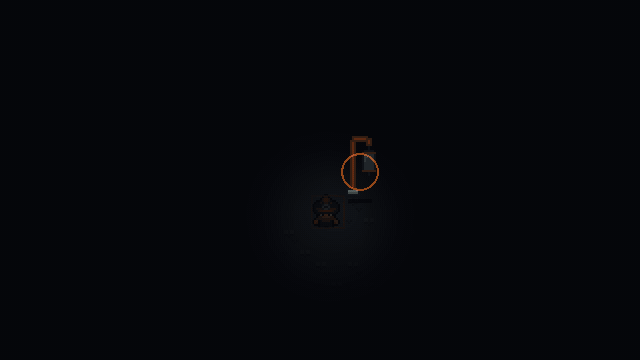
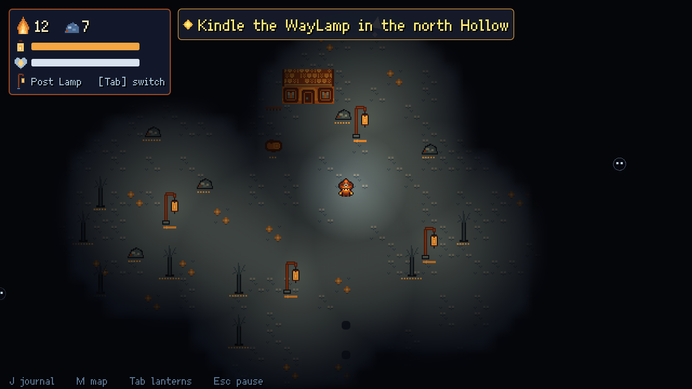
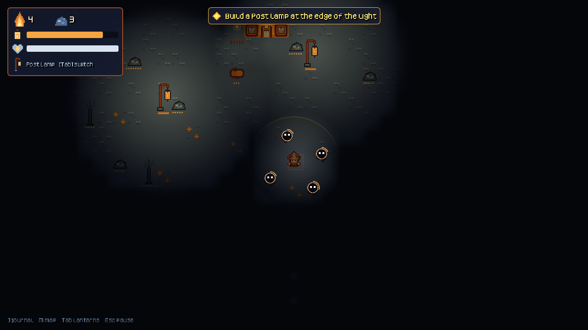
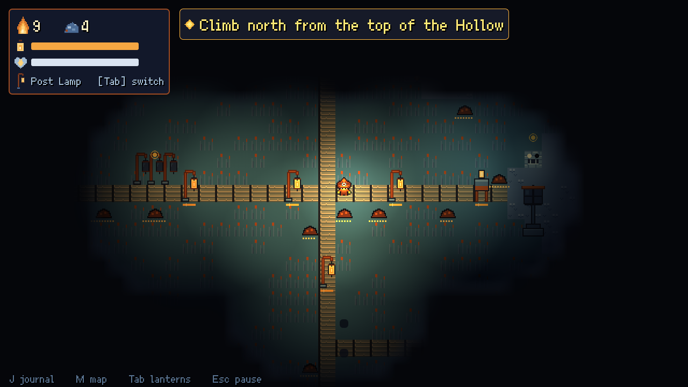
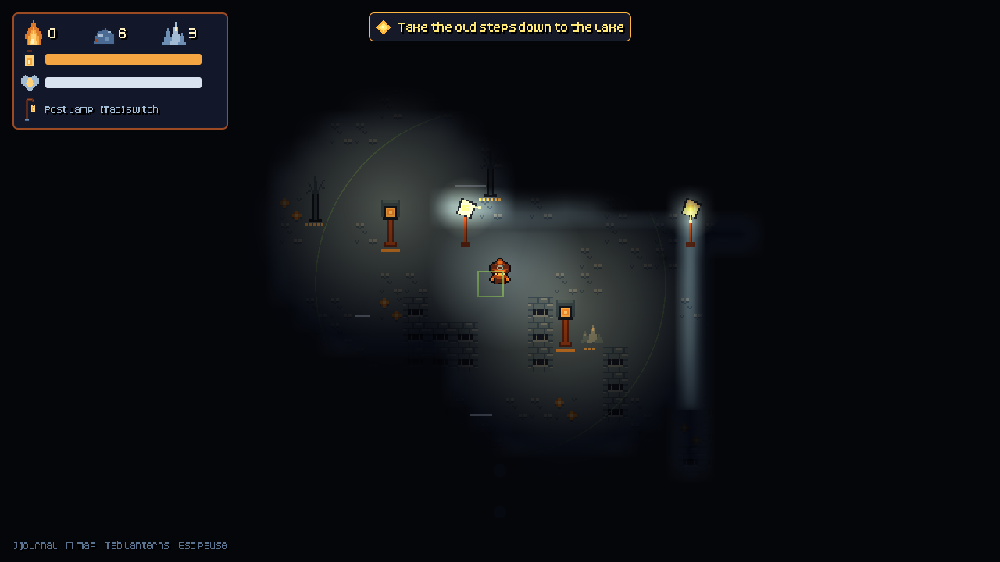
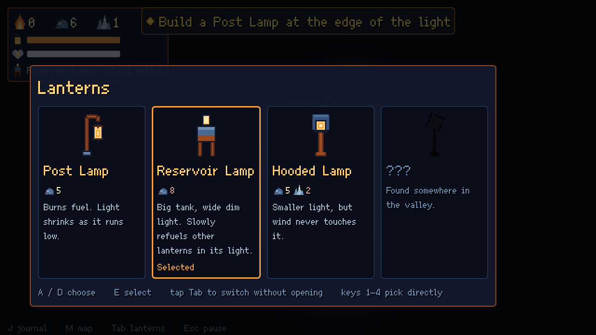
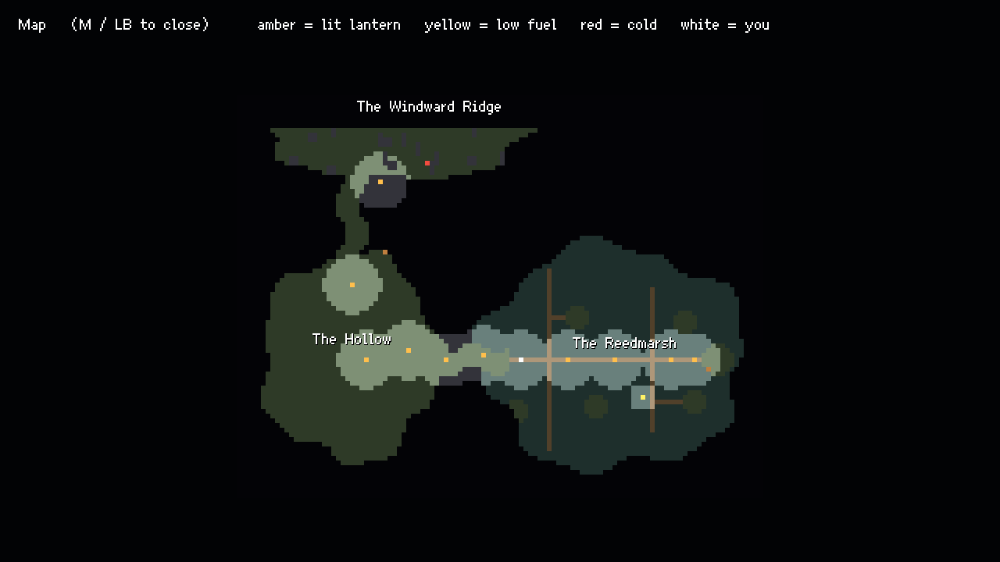
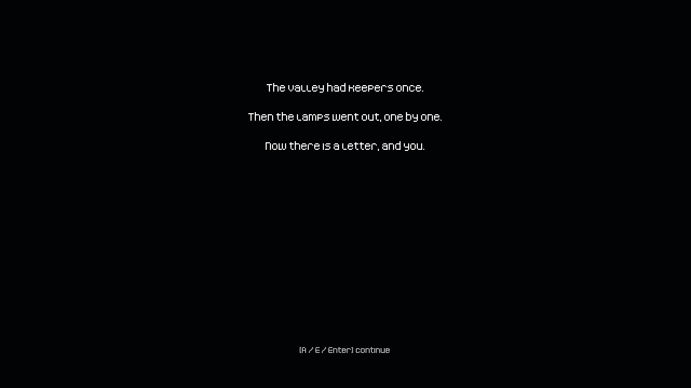
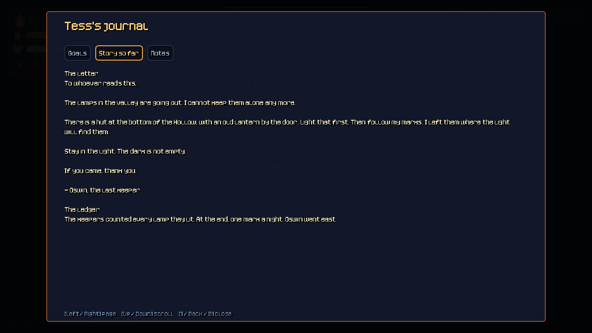

<h1 align="center">Lantern Keeper</h1>

<p align="center"><em>A quiet, moody 2D top-down game about tending lanterns and pushing back the dark.</em></p>

<p align="center">
  
  <br>
  <sub>Relighting the old lantern by the hut.</sub>
</p>

<p align="center">
  <a href="#about">About</a> ·
  <a href="#status">Status</a> ·
  <a href="#screenshots">Screenshots</a> ·
  <a href="#features">Features</a> ·
  <a href="#how-to-run-it">How to run it</a> ·
  <a href="#controls">Controls</a> ·
  <a href="#for-developers">For developers</a> ·
  <a href="#credits">Credits</a> ·
  <a href="#license">License</a>
</p>

## About

You are the new keeper of a dark, foggy valley. It had keepers once, until the lamps went out one by one. Now there is a letter from Oswin, the last keeper: light the old lantern by the hut, then follow his marks.

So you build lanterns, relight the ones that go cold, gather what the light reveals, and push the fog back a little at a time. Oswin's notes lead you across the valley, toward the Still Lake. The fun is in deciding where the light goes.

The game is calm and moody, with a quiet unease. Light is safety: in it you warm up, your hand lamp refills and nothing chases you. But the dark is not empty. Small shadows called Wicklings drain your lanterns and chill you. There is no death and no game over. If the cold gets you, you faint and wake by the nearest light.

## Status

Lantern Keeper is in development. It is a single-player game for PC (Linux first), made with Godot 4.7. You can play with keyboard and mouse or with a gamepad.

- Three regions are playable: the Hollow, the Reedmarsh and the Windward Ridge.
- The Still Lake and the ending come next.
- Some art and sound are still placeholders.
- There is no downloadable build yet. You can run the game from source (see [How to run it](#how-to-run-it)).
- Each region has an old WayLamp. Feed it fuel and keep the dark off it while it kindles, and the region is held: its lanterns stop burning down.

## Screenshots

<table>
  <tr>
    <td width="50%" valign="top">
      
      <br><sub><b>The Hollow</b> at night. Lanterns around the keeper's hut hold the fog back, while Wicklings watch from the dark.</sub>
    </td>
    <td width="50%" valign="top">
      
      <br><sub>At the edge of the light, the warding glow burns four Wicklings and pushes them back.</sub>
    </td>
  </tr>
  <tr>
    <td width="50%" valign="top">
      
      <br><sub><b>The Reedmarsh.</b> Lanterns stand on the boardwalks, peat waits in the reeds, and the fog comes back faster here.</sub>
    </td>
    <td width="50%" valign="top">
      
      <br><sub><b>The Windward Ridge.</b> Hooded Lamps keep burning in the wind, and two Mirror Posts pass a beam across the dark.</sub>
    </td>
  </tr>
  <tr>
    <td width="50%" valign="top">
      
      <br><sub>The lantern list. Each card shows what a lantern costs and what it does. Lanterns you haven't found yet stay hidden.</sub>
    </td>
    <td width="50%" valign="top">
      
      <br><sub>The map: explored ground, region names, and lanterns marked amber (lit), yellow (low) and red (cold).</sub>
    </td>
  </tr>
  <tr>
    <td width="50%" valign="top">
      
      <br><sub>A new game opens with a title card, then asks your keeper's name.</sub>
    </td>
    <td width="50%" valign="top">
      
      <br><sub>The journal, open on <i>Story so far</i>: Oswin's letter and the keeper's own entries.</sub>
    </td>
  </tr>
</table>

## Features

- **Fog that remembers.** Light pushes the fog back, and it creeps in again where the light fades. Ground you have seen stays as a dim haze, on screen and on the map. Ground you have never seen stays black.
- **Four lanterns.** You start with the Post Lamp and find the others in the valley.
  - **Post Lamp:** burns fuel, and its light shrinks as the fuel runs low.
  - **Reservoir Lamp:** a big tank and a wide, dim light. It slowly refuels the other lanterns in its light, even cold ones.
  - **Hooded Lamp:** a smaller light that the wind never touches.
  - **Mirror Post:** burns nothing. Place it in a lantern's light and it throws a long beam the way you turn it. Beams pass from mirror to mirror and stop at rock.
- **Fuel, scrap and glass.** Fuel comes from dead trees, peat and the woodpile by the hut, scrap from ruins, and glass from the Ridge. You only find things in the light, and lit spots slowly regrow. The woodpile always regrows, so you never run out of fuel for good.
- **Lanterns go cold.** An empty lantern keeps its frame. Cold and low lanterns pulse through the fog and get an arrow at the edge of the screen, so you can find them again.
- **Wind.** Gusts cross the valley after a short warning and make exposed lanterns burn faster. On the Windward Ridge the west wind never stops. Rock on the windward side shelters a lantern.
- **Wicklings and the warding glow.** Wicklings drift out of the deep fog to drain your lanterns and smother your mirrors. Hold F / RB / RT and your hand lamp swells into a warding glow that burns them and pushes them back. The glow runs on the lamp's own charge, never your fuel. Burned Wicklings leave an ember worth a little fuel.
- **No game over.** Warmth is your health. It drops when a Wickling touches you and comes back in lantern light. At zero you faint, drop some of what you carry, and wake by the nearest lit lantern (or the hut).
- **Story and guidance.** A short opening asks your keeper's name and gives you Oswin's letter. One goal at a time sits at the top of the screen, and an optional pointer shows the way. The journal keeps your goals, the story so far and every note you have read. Oswin's marks wait in the fog for your light to find them.
- **Finds worth the walk.** A keeper's satchel in each region lets you carry more, and a lamp glass makes your hand lamp reach further, dim more slowly and ward for longer.
- **The map.** It shows the ground you have explored, the regions you have found, and your lanterns, colored by how much fuel they have left.
- **Keyboard and mouse, or a gamepad.** Menus work without a mouse, and on-screen prompts show the buttons for the device you used last.
- **Save and autosave.** Three save slots, picked when the game starts. The game saves every minute, when you close the window, and when you choose Save in the pause menu.

## How to run it

There is no downloadable build yet, so you run the game from source.

1. Install [Godot 4.7](https://godotengine.org/download). The standard version is enough; the game is all GDScript.
2. Clone the repo:

   ```sh
   git clone https://github.com/tim-carey-code/lantern-keeper.git ~/Projects/lantern-keeper
   ```

3. In Godot's Project Manager, choose **Import**, pick `project.godot` in that folder, then press **F5** to play.

Or run it from the command line:

```sh
godot --path ~/Projects/lantern-keeper
```

On a fresh clone, import the project once before you run it from the command line. Opening it in the editor does this, or you can run `godot --headless --path ~/Projects/lantern-keeper --import`. If your Godot binary has another name, use that instead of `godot`.

The game starts fullscreen; F11 switches to a window. On Linux, your save is kept in `~/.local/share/godot/app_userdata/Lantern Keeper/`.

## Controls

| Action | Keyboard / mouse | Gamepad |
|---|---|---|
| Move | WASD / arrows | Left stick / D-pad |
| Read, refuel / relight, turn a Mirror Post right (tap); gather (hold) | E | A (bottom) |
| Turn a Mirror Post left (next to one) | Space / left click | X (left) |
| Build the selected lantern where you stand | Space / left click | X (left) |
| Pick up lantern | Q / right click | B (right) |
| Ward off Wicklings (hold) | F | RB / RT |
| Switch lantern (tap) / lantern list (hold) / pick 1-4 | Tab / 1-4 | Y (top) |
| Pause menu (resume, save, new game, save and quit, goal pointer, tips) | Esc | Start |
| Map | M | LB |
| Journal (goals, story so far, notes) | J | Back / View |
| Tuning panel (for development) | F1 | Left stick click |
| Fullscreen on/off | F11 | |

The pause menu also lists the controls for the device you are using.

## For developers

### Where things live

- `scenes/main/main.tscn`: the game scene. The valley is generated in code from a fixed seed, so it is the same in every game.
- `scripts/`: per-feature scripts: `main/` (builds the valley), `player/`, `lanterns/`, `resources/`, `enemies/`, `world/` (landmarks), `ui/`, `fx/`.
- `systems/`: game-wide systems and autoloads: placeholder numbers (`tuning.gd`), inventory, progress, save, story, input hints, fog, wind, light, audio and the Wickling spawner.
- `assets/`: files the game loads (art, audio, fonts, UI theme).
- `source/`: working files (Pixelorama `.pxo`, the palette, original third-party sheets). The game doesn't load these.
- `tools/`: input setup, headless tests, screenshot capture and placeholder-art scripts.
- `docs/`: design docs and the screenshots on this page.

Placeholder numbers live in `systems/tuning.gd`, and the tuning panel (F1) changes many of them while the game runs. The input actions are written by `tools/setup_input.gd`. To change a binding, edit that file and run `godot --headless --path . --script res://tools/setup_input.gd`; don't edit `[input]` in `project.godot` by hand. Rules for contributors, people and AI agents alike, are in [AGENTS.md](AGENTS.md).

### Tests

Run these from the project folder. `tools/run_tests.sh` runs them all and also fails a test that prints a script error (in the editor, a script error freezes the game in the debugger). A single test exits with code 0 when it passes. Tests use their own save file, so they never touch your real save, and they ignore any connected controller.

```sh
godot --headless --audio-driver Dummy --path . --import
tools/run_tests.sh                                                                             # all of the tests below
godot --headless --audio-driver Dummy --fixed-fps 60 --path . res://tools/tests/test_core.tscn   # exit 0 = pass
godot --headless --audio-driver Dummy --fixed-fps 60 --path . res://tools/tests/test_combat.tscn
godot --headless --audio-driver Dummy --fixed-fps 60 --path . res://tools/tests/test_threats.tscn
godot --headless --audio-driver Dummy --fixed-fps 60 --path . res://tools/tests/test_save.tscn
godot --headless --audio-driver Dummy --fixed-fps 60 --path . res://tools/tests/test_slots.tscn
godot --headless --audio-driver Dummy --fixed-fps 60 --path . res://tools/tests/test_ridge.tscn
godot --headless --audio-driver Dummy --fixed-fps 60 --path . res://tools/tests/test_story.tscn
godot --headless --audio-driver Dummy --fixed-fps 60 --path . res://tools/tests/test_waylamps.tscn
godot --headless --audio-driver Dummy --fixed-fps 60 --path . res://tools/tests/test_upgrades.tscn
godot --headless --audio-driver Dummy --fixed-fps 60 --path . res://tools/tests/test_leveling.tscn
# A test that fails to parse never quits: wrap runs in `timeout 120`.
godot --headless --audio-driver Dummy --fixed-fps 60 --path . --quit-after 1800                    # no errors
python3 tools/check_docs.py                                                                    # the docs still match the code
```

### Regenerating the screenshots

The images on this page are rendered from views set up in `tools/capture/capture.gd`. To render them again:

```sh
tools/capture/readme_shots.sh
```

The script needs Godot 4.7 (with the project imported once), `xvfb-run` and `ffmpeg`. It runs each view on a virtual display with no sound, copies the last frame into `docs/screenshots/` and builds `relight.gif`. Frames are kept in `~/.cache/lantern-keeper-shots`; set `SCRATCH` to use another folder.

### Docs

- [docs/DESIGN.md](docs/DESIGN.md): the design: systems, lanterns, regions and scope.
- [docs/STORY.md](docs/STORY.md): the story, the goals and every player-facing text. Contains spoilers.
- [docs/ROADMAP.md](docs/ROADMAP.md): milestones and where they stand.
- [docs/DECISIONS.md](docs/DECISIONS.md): the decisions log. Where it differs from the design doc, it wins.
- [docs/PLAYTEST.md](docs/PLAYTEST.md): playtest notes and results.
- [docs/ART_CHECKLIST.md](docs/ART_CHECKLIST.md): the art still to draw.
- [assets/CREDITS.md](assets/CREDITS.md): third-party assets and their licenses.
- [AGENTS.md](AGENTS.md): working rules for contributors and AI agents.

## Credits

The tiles and sound effects come from [Kenney](https://kenney.nl) and the keeper sprite is from Puny Characters by Shade, all CC0 1.0; some of the art is recolored to the game's palette. The font is [Ark Pixel](https://github.com/TakWolf/ark-pixel-font) by TakWolf, under the SIL Open Font License 1.1. The full list, with sources and licenses, is in [assets/CREDITS.md](assets/CREDITS.md).

## License
- **Code** (GDScript, shaders, scenes, project config, tools): MIT, see [LICENSE](LICENSE).
- **Art, audio, story, design docs, name and logo**: all rights reserved, see [LICENSE-ASSETS.md](LICENSE-ASSETS.md).
- **Third-party assets**: their own licenses, listed in [assets/CREDITS.md](assets/CREDITS.md).
